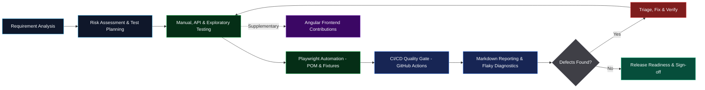
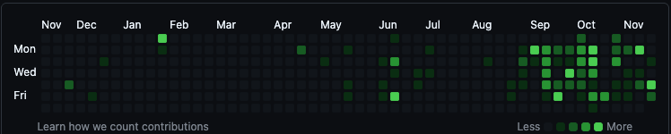

<div align="center">

# Hi there, I'm Md Salekin Newaz 👋

### Senior Software QA Engineer II @ Brain Station 23

*Quality Engineering | Playwright Automation | AI-Assisted QA | Angular & Frontend Contributions | ISTQB® Certified*

[](https://salekin-dev.vercel.app/)
[](https://www.linkedin.com/in/md-salekin-newaz)

</div>

---

## 👨‍💻 About Me

I am a **Senior Software QA Engineer II** with **5+ years of experience** in software quality assurance, currently working at **Brain Station 23**. My primary responsibility is **quality engineering ownership** — from requirement analysis and risk assessment through to release confidence — with frontend implementation as an additional engineering contribution alongside that core QA work.

- 🔍 **Quality Engineering Ownership:** Leading requirement analysis and risk assessment, designing test strategy, and owning release readiness across enterprise platforms.
- 🧪 **Comprehensive Testing:** Manual functional, exploratory and regression testing, API and integration testing, UAT and end-to-end validation.
- 🤖 **Test Automation:** Building maintainable **Playwright** automation suites in **JavaScript** and **TypeScript** using the **Page Object Model**, custom fixtures and reusable framework utilities.
- ⚙️ **CI/CD Quality Gates:** Integrating automated suites into **GitHub Actions** pipelines with parallel execution, so every pull request is validated automatically.
- 🤖 **AI-Assisted QA:** Leveraging **GitHub Copilot**, **Claude** and **MCP integrations** for AI-assisted test generation, failure triage and debugging workflows.
- 💻 **Frontend Engineering Contributions:** Contributing **Angular** and **TypeScript** UI improvements, implementing features and fixing frontend defects — presented here as a supplementary engineering capability, not my primary designation.

---

## 🎯 Quality Engineering & Core Expertise

| Capability | Detail |
| :--- | :--- |
| **Requirement Analysis** | Translating business requirements and user stories into verifiable acceptance criteria and test conditions. |
| **Risk Assessment & Test Planning** | Prioritising coverage by business and technical risk; defining scope, effort and exit criteria for each release. |
| **Test Design & Coverage** | Systematic, exploratory and boundary-value design across functional, integration and end-to-end levels. |
| **Regression & Release Testing** | Designing and maintaining regression suites that guard critical paths against unintended change. |
| **API & Integration Testing** | Validating service contracts, data integrity and cross-system behaviour using Postman and coded API suites. |
| **UAT & Stakeholder Collaboration** | Supporting acceptance testing cycles and liaising with product, engineering and business stakeholders. |
| **Defect Lifecycle Management** | Reproducing, isolating, prioritising and triaging defects through to verified resolution in **Jira**. |
| **Test Reporting & Metrics** | Communicating quality status, coverage and risk to both technical and non-technical stakeholders. |

---

## 🧪 Test Automation & Frameworks

- **Playwright** — E2E and API automation in **JavaScript** and **TypeScript**, engineered for stability, parallelism and low flake.
- **Page Object Model** — clean separation between test intent and page interaction, keeping suites readable and maintainable as features evolve.
- **Custom Fixtures** — reusable setup/teardown primitives that encapsulate authentication, seeded data and environment configuration.
- **Framework Design** — modular suites structured for reuse across projects and multi-environment CI pipelines.
- **CI/CD Integration** — automated execution on **GitHub Actions**, including parallel workers, retry handling and rich in-CI reporting.
- **API Automation** — coded request validation with schema assertions alongside manual **Postman** collections.

---

## 🧠 AI-Assisted Quality Engineering

AI tooling is integrated into my QA workflow as a **force multiplier for test design and debugging** — not as a replacement for engineering judgement.

- **AI-Assisted Test Generation** — using **GitHub Copilot** and **Claude** to accelerate scenario ideation, boundary-case discovery and initial test scaffolding.
- **AI-Assisted Debugging** — analysing failing test output and stack traces to narrow down root causes faster than manual triage alone.
- **MCP Integrations** — connecting AI assistants to development tooling and repository context to ground suggestions in the actual codebase.
- **Custom AI Reporting** — shipping an **AI debugging prompt** in my own Playwright reporter that bundles every failure into a copy-ready prompt for Copilot, Claude or Cursor.

---

## 💻 Frontend Engineering Contributions

Alongside my primary QA responsibilities, I contribute to the frontend layer of enterprise products. This work strengthens my quality engineering because **shipping and reading the code makes me a more effective tester** — but it remains an additional contribution, not my professional designation.

- **Angular & TypeScript Contributions** — implementing UI features, refining component behaviour and improving interface responsiveness.
- **Frontend Defect Resolution** — diagnosing and fixing frontend bugs raised through testing, reducing defect leakage into production.
- **Testability Advocacy** — collaborating with frontend engineers on testability improvements and seam design for reliable automation.
- **Shared Delivery Cycle** — participating in feature discussions and pull request reviews alongside frontend and QA squads.

---

## 🔄 My Quality Engineering Workflow



> Quality engineering is the primary workflow. Angular frontend work runs as a **supplementary engineering activity** alongside it.

---

## 🧰 Core Tech Stack & Tooling

| Domain | Technologies & Tools |
| :--- | :--- |
| **Quality Engineering** | `Manual Testing` `Test Planning` `Test Design` `API Testing` `Regression Testing` `Exploratory Testing` `UAT` `Defect Triage` |
| **Test Automation** |       `POM` `Custom Fixtures` |
| **Frontend Contributions** |      |
| **AI-Assisted QA** | `GitHub Copilot` `Claude` `MCP Integrations` `AI-Assisted Test Generation` `AI-Assisted Debugging` |
| **CI/CD & Engineering** |     `Jira` `MySQL` `Docker` |

---

## 🚀 Featured Projects & Open Source

### 📊 [`playwright-summary-reporter`](https://github.com/salekinnewaz/playwright-summary-reporter) — *Open-Source Playwright Reporter*

[](https://www.npmjs.com/package/playwright-summary-reporter)
[](https://opensource.org/licenses/MIT)

A **zero-dependency Playwright custom reporter** that turns a test run into a clean, readable **Markdown dashboard** — locally and directly into the **GitHub Actions Job Summary** tab.

**What it does**
- Converts raw Playwright output into a structured, human-readable Markdown report.
- Auto-appends to `GITHUB_STEP_SUMMARY` — no extra workflow wiring required.

**Key features**
- 🎨 **GitHub-flavored alert card** — a green `> [!TIP]` for a clean run, a red `> [!CAUTION]` otherwise.
- 📊 **KPI summary table** with pass rate and a proportional 12-block health bar.
- 🥧 **Native Mermaid pie chart** rendered by GitHub itself.
- 🎯 **Deterministic failure badges** — every failure classified as Assertion, Timeout, Locator or Runtime.
- ⚠️ **Flaky test diagnostics** — a dedicated flaky-tests table with retry counts.
- 🐢 **Top-N slowest tests** with relative duration bars.
- 🔁 **Copy-ready re-run command** — `npx playwright test <file>:<line>` for exactly the failed tests.
- 🤖 **AI debugging prompt** — a collapsible accordion bundling every failure for **Copilot / Claude / Cursor**.
- 🔢 **Airtight totals** — `Total === Passed + Failed + Flaky + Skipped`, always.

**Implementation**
- Written in **TypeScript** with shipped type declarations (`dist/index.d.ts`).
- **Zero runtime dependencies** — only Node.js built-ins (`fs`, `path`).
- Requires Node.js 18+ and `@playwright/test >=1.40.0` (peer dependency).
- Covered by its own **GitHub Actions** CI pipeline.

```bash
npm install -D playwright-summary-reporter
```

[📦 View on npm](https://www.npmjs.com/package/playwright-summary-reporter) · [⭐ Source on GitHub](https://github.com/salekinnewaz/playwright-summary-reporter)

---

### 🧠 [`Assignment_BS_LMS`](https://github.com/salekinnewaz/Assignment_BS_LMS) — *AI-Assisted Project Initiation Assistant*

- Five **Agent Skills** that transform client meeting notes into a development-ready backlog — PRD, epics, user stories, acceptance criteria and estimates.
- Generates a companion Google Sheets project tracker to keep planning artefacts and delivery status in sync.
- Demonstrates applying AI beyond test execution — into the **upstream requirement and planning phase** of quality engineering.

### 🌐 [`salekin-dev`](https://github.com/salekinnewaz/salekin-dev) — *Personal Portfolio & QA Practice Ground*

- Next.js 15 portfolio presenting my QA engineering work, built with **Playwright** and AI-driven QA practices.
- Serves as a living testbed for applying automation, reporting and AI-assisted workflows end to end.

---

## 🏢 Professional Experience & NDA-Safe Contributions

> *Client codebases are hosted in private repositories under NDA. The following summarises my domain impact without disclosing confidential client or project information.*

- **Quality Engineering Ownership:** Owning test strategy, requirement analysis, risk assessment and release readiness for enterprise platforms in the **Norway-based energy & well-engineering sector**.
- **Parallel Quality Assurance:** Building and maintaining **Playwright** E2E and API regression suites alongside feature delivery to protect against regressions across multi-environment CI pipelines.
- **Cross-Functional Collaboration:** Contributing to feature discussions, reviewing pull requests, and advocating for testability improvements alongside frontend and QA squads.
- **Frontend Contributions:** Implementing **Angular** UI features and resolving frontend defects raised through testing, within an NDA-bound enterprise delivery cycle.

---

## 📈 GitHub Activity & Contributions

<div align="center">



*464 contributions across enterprise & open-source repositories (captured prior to client repository migration to GitLab).*

<br/>


</div>

---

## 🤝 Let's Connect

Interested in discussing **Quality Engineering, Playwright Test Automation, AI-Assisted QA, or Open-Source Collaboration**? Let's connect:

- 🌐 **Portfolio:** [https://salekin-dev.vercel.app/](https://salekin-dev.vercel.app/)
- 💼 **LinkedIn:** [https://www.linkedin.com/in/md-salekin-newaz](https://www.linkedin.com/in/md-salekin-newaz)
- 🐙 **GitHub:** [https://github.com/salekinnewaz](https://github.com/salekinnewaz)
