# Hi there, I'm Md Salekin Newaz 👋

### Senior Software QA Engineer II & Frontend Developer (Angular) @ Brain Station 23

*Bridging Quality Engineering & Modern Frontend Development — building resilient Angular applications and scalable Playwright automation architectures.*

---

### 👨‍💻 About Me

I am a **Senior Software QA Engineer II** expanding into **Angular Frontend Development**, working at the intersection of feature engineering and automated quality assurance. Currently, I contribute to enterprise **Norway-based Energy & Oil/Gas well-engineering platforms**, developing frontend features, resolving production issues, and building parallel automated test suites.

- 💻 **Frontend Engineering (Angular):** Implementing responsive UI features, resolving complex frontend bugs, and collaborating directly in full-stack product delivery cycles.
- 🏗️ **Test Architecture & Automation:** Designing modular, maintainable E2E and API automation suites using **Playwright**, **TypeScript**, and **Python** (Page Object Model & custom fixtures).
- 🔄 **Parallel Dev + QA Workflow:** Writing features and automated regression tests side-by-side—catching edge cases early and accelerating release velocity.
- 🛠️ **Open-Source QA Tooling:** Creator of **[playwright-summary-reporter](https://github.com/salekinnewaz/playwright-summary-reporter)**—a zero-dependency custom Playwright reporter that generates clean Markdown test summaries for local runs and GitHub Actions.

---

### 🔄 How I Work: Parallel Development & Quality Workflow

```mermaid
flowchart LR
    A[📐 Feature & Bug Analysis] --> B[🅰️ Angular UI Implementation]
    B --> C[🧪 Parallel Playwright E2E & API Tests]
    C --> D[⚙️ CI/CD Quality Gate\nGitHub Actions / GitLab CI]
    D --> E[📊 Custom Markdown Reporting]
    E --> F[🚀 Confident Production Release]

    style A fill:#1e293b,stroke:#38bdf8,color:#f8fafc
    style B fill:#3b0764,stroke:#e11d48,color:#f8fafc
    style C fill:#052e16,stroke:#22c55e,color:#f8fafc
    style D fill:#172554,stroke:#3b82f6,color:#f8fafc
    style E fill:#31102f,stroke:#c084fc,color:#f8fafc
    style F fill:#064e3b,stroke:#10b981,color:#f8fafc
```

---

### 🧰 Core Tech Stack & Tooling

| Domain | Technologies & Tools |
| :--- | :--- |
| **Frontend Development** |      |
| **Test Automation** |     |
| **CI/CD & DevOps** |    |
| **Engineering Practices** | `Angular Feature Dev` `Bug Fixing` `E2E & API Automation` `Shift-Left Testing` `Parallel CI Execution` `Code Review` |

---

### 🚀 Featured Work & Enterprise Highlights *(NDA-Safe)*

> *Note: Enterprise client codebases are hosted in private GitHub & GitLab repositories under NDA. Below is an overview of my domain impact and open-source work.*

#### 1. 🛢️ Enterprise Well & Gas Engineering Solutions *(Norway-Based Domain)*
- **Dual Role (Frontend + QA):** Actively contributing to multiple enterprise platforms in the Norwegian energy/well-engineering sector—implementing new **Angular** UI features, diagnosing & fixing frontend defects, and validating complex engineering workflows.
- **Parallel Quality Engineering:** Building and maintaining **Playwright** E2E & API regression suites alongside feature development to ensure zero-regression deployments across multi-environment CI pipelines (**GitHub Actions & GitLab CI**).
- **Cross-Team Collaboration:** Participating in feature architecture discussions, pull request reviews, and testability improvements across frontend and QA squads.

#### 2. 📊 [`playwright-summary-reporter`](https://github.com/salekinnewaz/playwright-summary-reporter) — *Open-Source Custom Reporter*
- Built a lightweight, zero-dependency TypeScript custom reporter for Playwright.
- Automatically generates structured Markdown test execution summaries, failure diagnostics, and flaky-test insights for **GitHub Actions Job Summaries** and local terminal runs.

---

### 📈 GitHub Activity & Contributions

---

### 🤝 Let's Connect

Interested in discussing **Angular Frontend Development, Playwright Test Automation, Quality Engineering, or Open-Source Collaboration**? Let's connect:

- 🌐 **Portfolio:** [https://salekin-dev.vercel.app/](https://salekin-dev.vercel.app/)
- 💼 **LinkedIn:** [https://www.linkedin.com/in/md-salekin-newaz](https://www.linkedin.com/in/md-salekin-newaz)
